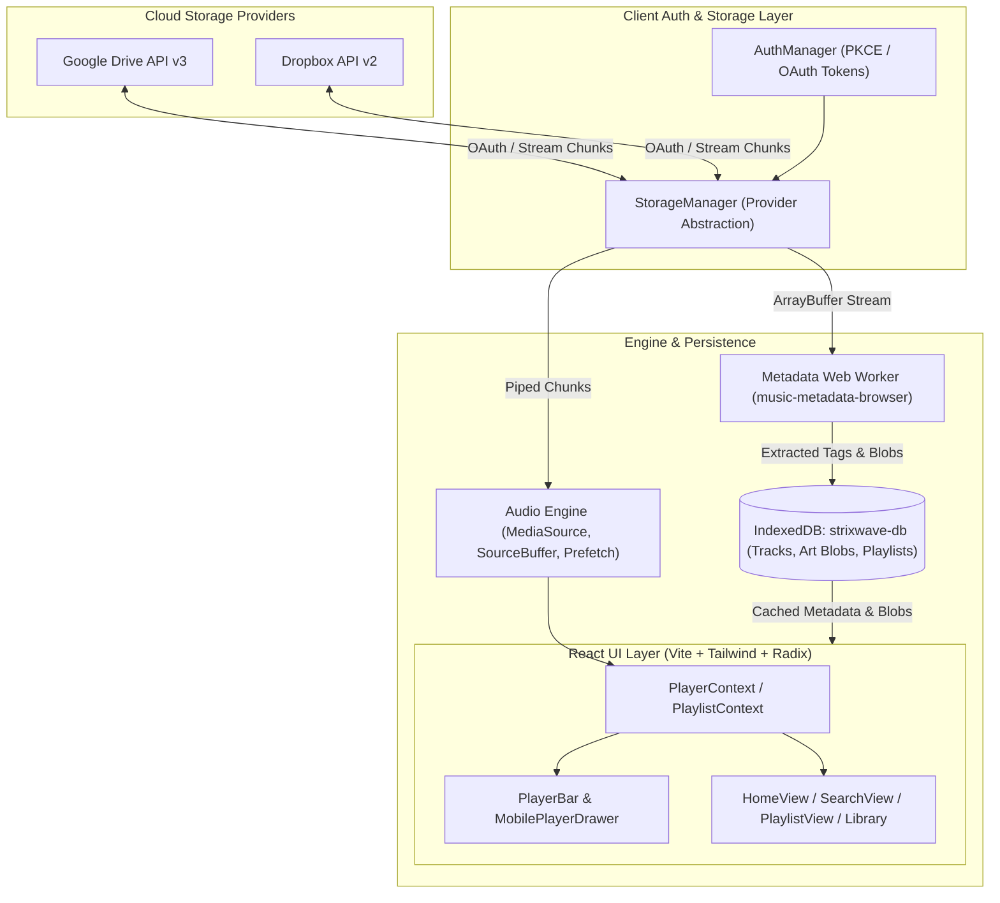

# StrixWave — Cloud-Connected Hi-Fi Music Streaming Web App

<p align="center">
  
  
  
  
  
  
  
</p>

---

## 📌 Overview

**StrixWave** is an open-source, client-side cloud music streaming player that turns your personal **Google Drive** and **Dropbox** storage into a private Spotify-like streaming service.

Running entirely in the browser without requiring a dedicated backend server, StrixWave connects to your cloud accounts via OAuth, scans audio files with multi-threaded Web Workers, indexes metadata and cover art into local IndexedDB storage, and streams music through an advanced **Media Source Extensions (MSE)** gapless audio playback engine.

---

## ✨ Features

- ☁️ **Multi-Cloud Audio Storage**: Connect multiple Google Drive and Dropbox storage accounts seamlessly via OAuth 2.0 PKCE.
- ⚡ **MSE-Based Gapless Audio Engine**:
  - Implements custom Media Source Extensions (MSE) chunked streaming (256 KB chunks).
  - Background track prefetching (buffers upcoming tracks ~30 seconds before completion).
  - Memory-managed buffer recycling with a 50 MB hard cap to prevent mobile browser memory pressure.
  - Supports MP3, M4A/AAC, Opus, and WebM audio formats.
- 🧵 **Multi-Threaded Metadata Extraction**: Uses `music-metadata-browser` inside a dedicated Web Worker (`metadata.worker.ts`) to parse ID3 tags, artist, album, bitrate, and embedded album artwork off the UI thread without dropping frames.
- 🗄️ **Persistent Local Cache (IndexedDB)**:
  - Custom schema (`strixwave-db` v3) indexing tracks, artists, albums, and playlists.
  - Caches album art blobs directly in IndexedDB for instant, offline-capable image rendering.
- 🎨 **Adaptive Dynamic UI**:
  - Automatically extracts dominant color palettes from active album art (`color-utils.ts`) to tint the player background and control glows.
  - Built with Tailwind CSS and Radix UI primitives.
- 📱 **Responsive Desktop & Mobile Layout**:
  - **Desktop**: Collapsible navigation sidebar, split pane layouts, track detail inspector, and fixed bottom player bar.
  - **Mobile**: Touch-optimized bottom navigation, gesture-driven bottom-sheet player drawer (`vaul`), and compact queue manager.
- 🔍 **Instant Client-Side Search & Discovery**: Real-time fuzzy query filtering across your entire aggregated library by track title, artist, or album.
- 📑 **Comprehensive Playlist & Queue Management**: Create custom playlists, mark favorites, re-order playback queues, toggle shuffle mode, and cycle loop states (repeat one, repeat all).

---

## 🏗️ Architecture & Data Flow



---

## 📂 Project Structure

```txt
StrixWave/
├── src/
│   ├── main.tsx                  # Application bootstrap & providers
│   ├── App.tsx                   # Main route switch & layout coordinator
│   ├── index.css                 # Tailwind directives, theme variables & scrollbars
│   ├── components/               # React UI Components
│   │   ├── AlbumCard.tsx         # Card item with cover and play actions
│   │   ├── ConnectionManager.tsx # Cloud accounts connection modal
│   │   ├── ErrorBoundary.tsx     # Runtime error boundary with fallback UI
│   │   ├── HomeView.tsx          # Recently played, recommendations & stats
│   │   ├── MobileBottomNav.tsx   # Mobile bottom navigation bar
│   │   ├── MobilePlayerDrawer.tsx# Fullscreen sliding player sheet (Vaul)
│   │   ├── PlayerBar.tsx         # Desktop bottom audio controller
│   │   ├── PlaylistView.tsx      # Playlist view & tracklist editor
│   │   ├── Queue.tsx             # Interactive queue side-panel
│   │   ├── SearchView.tsx        # Dynamic search and filter view
│   │   ├── Sidebar.tsx           # Collapsible desktop navigation
│   │   ├── TrackCover.tsx        # Responsive cover art with blob fallback
│   │   └── YourLibrary.tsx       # Aggregated artist/album/track library
│   ├── context/
│   │   ├── PlayerContext.tsx     # Global audio player state & queue actions
│   │   └── PlaylistContext.tsx   # Playlist CRUD & persistence sync
│   ├── hooks/
│   │   ├── useAudioEngine.ts     # MSE gapless buffer & playback engine
│   │   ├── useAuth.ts            # Cloud auth session hook
│   │   ├── useHistoryHook.ts     # In-app navigation history stack
│   │   └── use-mobile.tsx        # Screen breakpoint detector
│   ├── lib/
│   │   ├── audio-utils.ts        # Time formatters & audio calculations
│   │   ├── color-utils.ts        # Canvas-based palette extraction
│   │   └── utils.ts              # ClassName helpers (clsx / twMerge)
│   └── services/
│       ├── db.ts                 # IndexedDB client (tracks & playlists stores)
│       ├── DiscoveryEngine.ts    # Fuzzy search & metadata indexing
│       ├── metadata.worker.ts    # Web Worker for background ID3 tag extraction
│       ├── auth/                 # OAuth PKCE managers (Google, Dropbox)
│       └── storage/              # Chunked cloud fetch & stream providers
├── vite.config.ts                # Vite build config & path aliases
├── tailwind.config.js            # Tailwind typography, theme & animations
└── package.json                  # Dependencies and build scripts
```

---

## ⚡ Getting Started

### Prerequisites
- **Node.js**: v18.0 or higher (v20+ recommended)
- **pnpm** (recommended) or **npm** / **yarn**

### Installation

1. **Clone the repository:**
   ```bash
   git clone https://github.com/ShihabulSakib/StrixWave.git
   cd StrixWave
   ```

2. **Install dependencies:**
   ```bash
   pnpm install
   # Or using npm:
   npm install
   ```

3. **Start the local development server:**
   ```bash
   pnpm dev
   ```

4. Open your browser and navigate to `http://localhost:5173`.

---

## 🔑 Cloud Storage Configuration

To enable cloud library sync, create API applications in Google Cloud Console and Dropbox Developer Portal:

### 1. Google Drive (OAuth 2.0 PKCE)
1. Go to the [Google Cloud Console](https://console.cloud.google.com/).
2. Create a project and enable the **Google Drive API**.
3. Under **Credentials**, create an **OAuth 2.0 Client ID** (Application type: *Single-page application*).
4. Add Authorized JavaScript origins: `http://localhost:5173` (and your production domain).
5. Add Authorized Redirect URIs: `http://localhost:5173` (and your production URL).
6. Enable the `drive.readonly` or `drive.file` scope.

### 2. Dropbox (OAuth 2.0 PKCE)
1. Navigate to the [Dropbox App Console](https://www.dropbox.com/developers/apps).
2. Create an app with **Scoped access** and **Full Dropbox** (or **App folder**) access.
3. Under **Permissions**, enable `files.content.read` and `files.metadata.read`.
4. In the **Settings** tab, add your Redirect URI (e.g. `http://localhost:5173`).

Connect your accounts directly inside the StrixWave UI by clicking the **Connect Cloud** button in the sidebar.

---

## 🛠️ Build & Production

To compile optimized production assets:

```bash
# Type-check and production build
pnpm build

# Preview production build locally
pnpm preview
```

The compiled output will be generated in `dist/`, ready to deploy to any static hosting provider (Vercel, Cloudflare Pages, Netlify, or GitHub Pages).

---

## 🔊 Audio Engine Capabilities

| Feature | Implementation Detail |
|---|---|
| **Streaming Protocol** | Media Source Extensions (`MediaSource` & `SourceBuffer`) |
| **Chunking** | 256 KB sliced fetch chunks for instant time-to-first-sound |
| **Prefetching** | Automatically pre-buffers the next track when 30 seconds remain |
| **Memory Ceiling** | Enforces a 50 MB hard cap buffer eviction policy |
| **Codecs** | AAC (`audio/mp4`), MP3 (`audio/mpeg`), Opus (`audio/webm`) |
| **Tag Decoding** | Multi-threaded Web Worker offload (`music-metadata-browser`) |
| **Artwork Storage** | Native binary Blob caching in IndexedDB with Object URLs |

---

## 📄 License

This project is licensed under the [MIT License](LICENSE).
